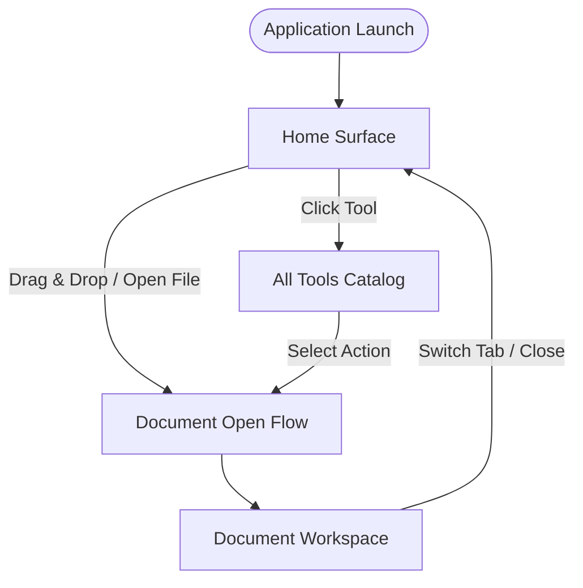
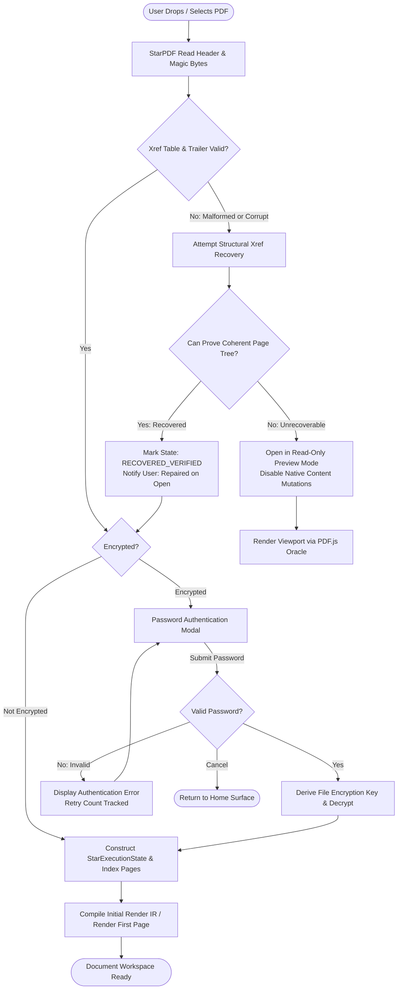
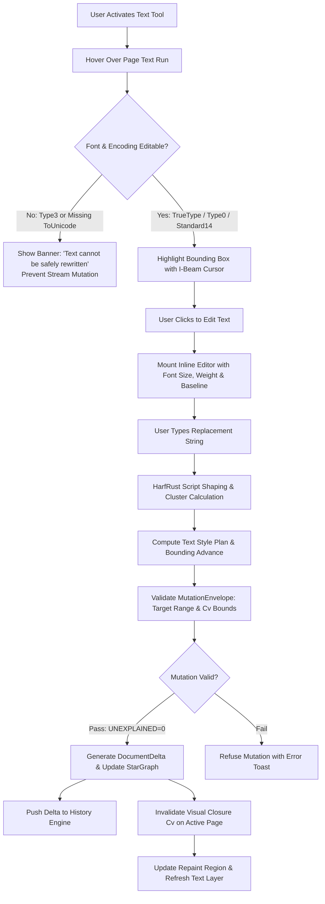
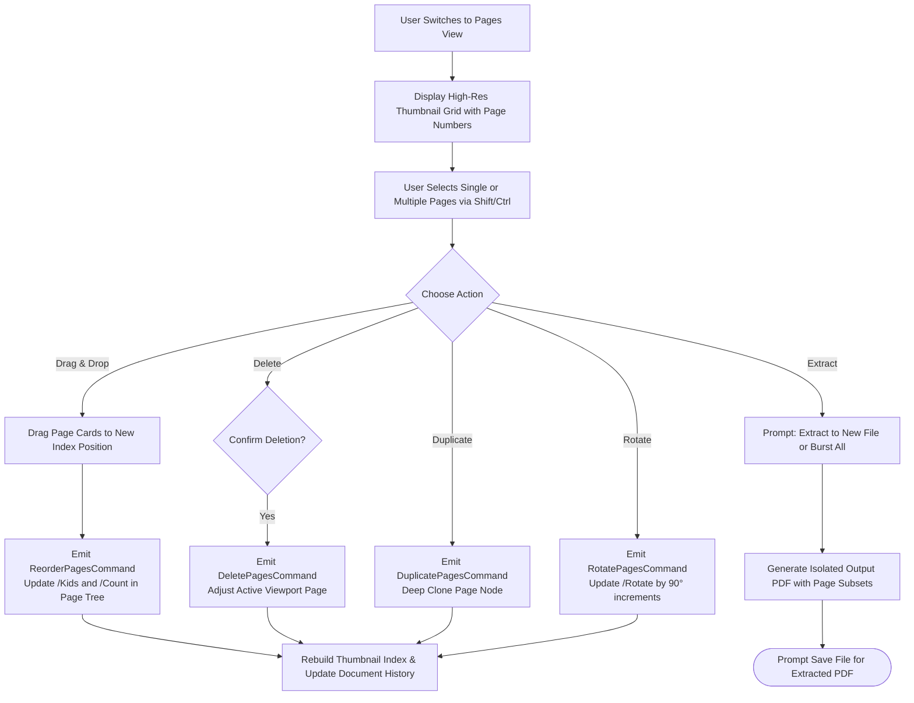
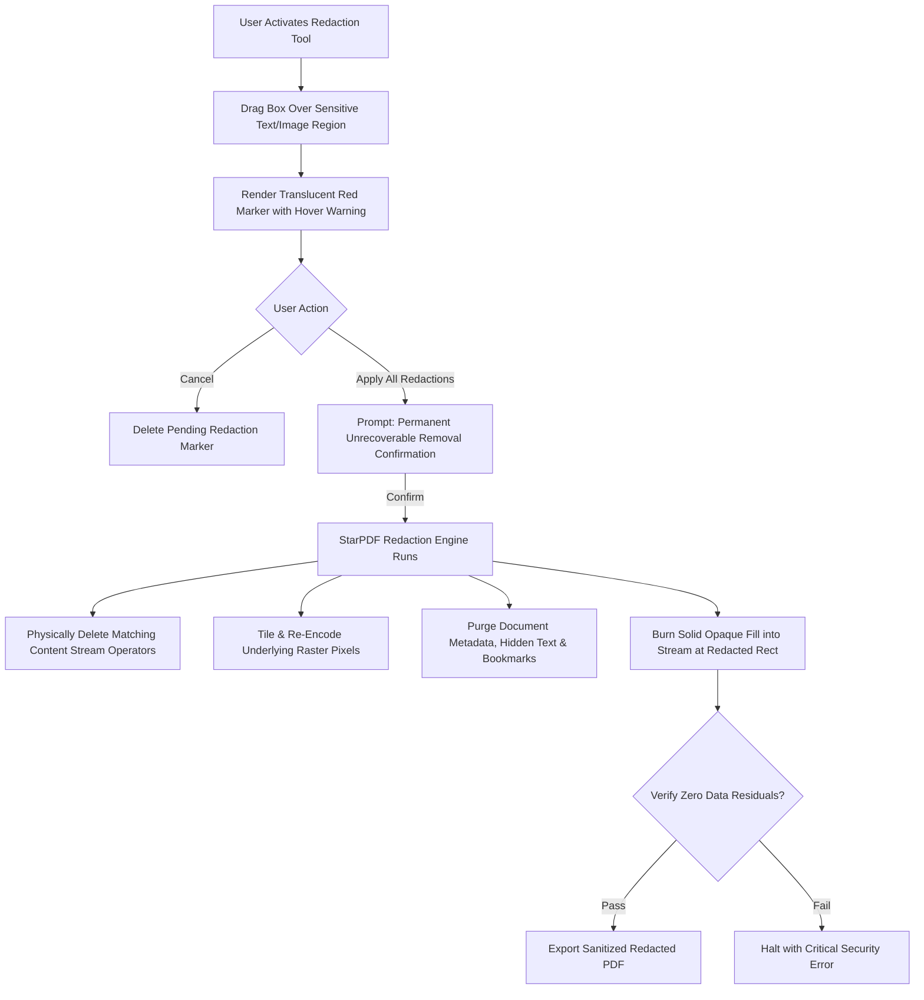

# SmartPDF Application Flows & User Interaction Specification

**Document ID:** DOC-FLOW-001  
**Status:** CANONICAL DRAFT (Phase 0 / Pre-Implementation)  
**System:** SmartPDF Desktop & Web  
**Baseline Commit:** `f7ff85464b190b74c89c1f8be9862be37090dd7f` (`arch/integrated`)  

---

## 1. High-Level Workspace Architecture

SmartPDF follows a three-surface workflow model familiar to creative and professional document users:
1. **Home Surface:** Recent documents, pinned templates, quick open, and storage shortcuts.
2. **All Tools Surface:** Categorized catalog of all PDF editing, conversion, organization, and security tools with instant search.
3. **Document Workspace:** Full-viewport, document-centric editing workspace with top toolbar, left thumbnail/bookmark rail, dominant canvas viewport, and contextual floating action bars.

---

## 2. Document Open & Security Flows

### 2.1 Standard Open & Fault-Tolerant Recovery Flow

### 2.2 Security Refusal Flow (Fail-Closed)
When a user attempts an action prohibited by document permissions or cryptographic protection:
1. User clicks or shortcuts an action (e.g., Edit Text on a signed document or restricted print file).
2. `starpdf-app-core` queries `StarSecurityInfo.capabilities`.
3. If permission flag is absent or `signed_mutation_state == MutationRefused`:
   - Canvas suppresses editing handles and cursor remains default.
   - Non-intrusive security badge displays refusal reason (e.g., *"Editing prohibited: Document contains digital signatures that forbid post-signing alterations."*).
   - Document state remains 100% unaltered.

---

## 3. Core Editing Flows

### 3.1 Native Existing-Text Editing Flow

### 3.2 Raster Image Editing Flow
1. **Activation:** User clicks the Image tool or clicks directly on an embedded graphic in Select mode.
2. **Selection:** Bounding box overlay appears with 8 transform handles and contextual quick actions:
   - *Replace Image*, *Delete*, *Extract / Save Image*, *Crop*, *Move / Resize*.
3. **Move & Resize:** User drags image corner:
   - Live bounding guide updates on canvas.
   - On mouse release, `starpdf-app-core` emits `MoveResizeImageCommand(image_ref, new_rect)`.
   - Engine verifies image resource is isolated; if shared across multiple pages, it transparently duplicates the XObject dictionary to ensure other pages remain untouched.
4. **Replacement:** User selects replacement JPEG/PNG:
   - Engine decodes image headers, creates replacement `/XObject /Subtype /Image` stream with identical or updated dimensions, and splices the resource reference.

---

## 4. Document Assembly & Page Management Flows

### 4.1 Page Organizer Flow

---

## 5. Review, Annotation & Forms Flows

### 5.1 FreeText & Markup Annotation Flow
1. User clicks **FreeText** (or Highlight, Shape, Sticky Note).
2. User clicks or drags a rectangle on the document viewport.
3. Instant optimistic canvas element appears for interactive input:
   - Rich contextual styling bar floats adjacent to annotation (Font Family, Size, Stroke Color, Fill Color, Opacity).
4. On focus blur or typing commit:
   - StarPDF constructs annotation dictionary (`/Type /Annot /Subtype /FreeText`).
   - Engine dynamically generates ISO 32000-compliant `/AP` (Appearance Stream) with embedded fonts.
   - Delta updates page `/Annots` array and records `rn1` render node identity.

### 5.2 AcroForm Filling & Design Flow
- **Filling Mode:**
  - Cursor changes to Hand/Pointer over form widgets.
  - Clicking a text field focuses native input with automatic font sizing.
  - Clicking a checkbox toggles state (`/AS /Yes` vs `/AS /Off`) with immediate `/AP` refresh.
  - Radio buttons enforce mutual exclusivity within their parent field group.
  - Dropdown menus present clean selection overlays with immediate `/V` binding.
- **Designer Mode:**
  - Palette exposes Text Field, Checkbox, Radio Button, List Box, Dropdown, Signature Field.
  - User drags to create new field bounding boxes, binds field names, and sets default export values.

---

## 6. Advanced Document Intelligence Flows

### 6.1 Search & Replace Flow
1. User triggers `Cmd+F` / `Ctrl+F` search drawer.
2. User inputs query string (supports Case Sensitive, Whole Word, Regex).
3. StarPDF scans parsed content streams and builds hit index:
   - Returns exact match count and page numbers.
   - Highlights all matches on active page with translucent yellow badges.
   - Cycles active match with `Enter` / `Shift+Enter` and scrolls viewport smoothly.
4. **Batch Replace:**
   - User enters replacement text and clicks *Replace All*.
   - Engine executes sequential `replaceText` mutations across all verified matches within a single undoable transaction.

### 6.2 Permanent Redaction Flow

---

## 7. Lifecycle, History & Persistence Flows

### 7.1 Undo & Redo Flow
1. User presses `Cmd+Z` / `Ctrl+Z` (Undo) or `Cmd+Shift+Z` / `Ctrl+Y` (Redo).
2. `starpdf-app-core` pops the most recent `DocumentDelta` from the history stack:
   - Delta contains reverse inverted operations for objects, references, and ranges.
3. Engine applies inverted delta to `StarGraph`.
4. Visual closure $C_v(\Delta)$ is calculated for invalidated page areas.
5. Viewport triggers localized repaint; selection updates to reflect previous state.

### 7.2 Crash Recovery & Autosave Flow
- Every 5 seconds during active editing, `starpdf-app-core` writes an append-only JSON journal to private local storage (IndexedDB / OS application support folder).
- On application startup:
  - System checks for uncommitted journal entries with dangling session IDs.
  - If detected, displays **"Recover Unsaved Work"** dialogue with document name, timestamp, and modification count.
  - Upon user confirmation, reconstructs exact document state from base file plus journal deltas.
