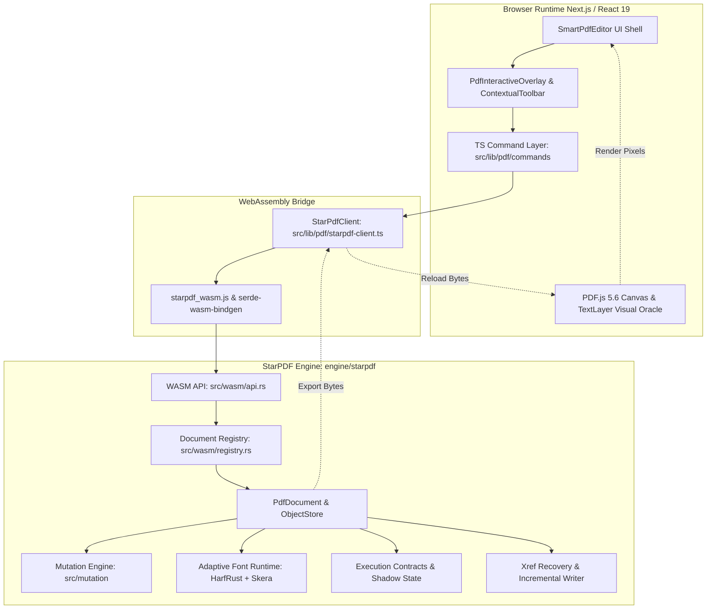
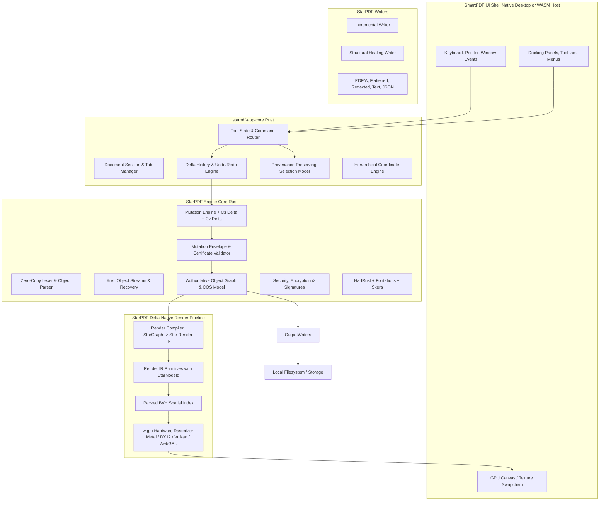

# SmartPDF / StarPDF Technical Requirements Document (TRD)

**Document ID:** DOC-TRD-001  
**Status:** CANONICAL QUALIFIED (Phase 0 / Pre-Implementation)  
**System:** SmartPDF Application & StarPDF Engine  
**Baseline Commit:** `f7ff85464b190b74c89c1f8be9862be37090dd7f` (`arch/integrated`)  
**Target Architecture:** Rust-First Native Cross-Platform Application  

---

## 1. Architectural Philosophy & Invariants

SmartPDF is architected on the principle of **Authoritative Rust Ownership** with **Zero C-Dependencies**. While existing web implementations provide an initial working baseline, the long-term system mandates that all PDF state, mutation semantics, selection identity, undo/redo history, security gating, file export, and native rendering reside in Rust.

### Core Mathematical Invariants
1. **Delta State Evolution:**
   $$G(t+1) = G(t) \oplus \Delta$$
   Every document state transition is an explicit, immutable delta applied to the authoritative document graph.
2. **Certified Zero Unexplained Change:**
   $$\text{UNEXPLAINED CHANGE}(\Delta) = 0$$
   A mutation is refused by the engine if any modified object, source range, or resource reference falls outside the declared `MutationEnvelope`.
3. **Bounded Structural Mutation Time:**
   $$T(\text{edit}) \approx \mathcal{O}(|C_s(\Delta)|)$$
   Execution time depends strictly on the size of the structural dependency closure $C_s(\Delta)$, never on total document size.
4. **Bounded Visual Invalidation:**
   $$T(\text{render}) \approx \mathcal{O}(|C_v(\Delta)| + \log N)$$
   Repaint time is bounded by the visual closure $C_v(\Delta)$ queried through a spatial index over $N$ primitives.
5. **Bounded Serialization Time:**
   $$T(\text{write}) \approx \mathcal{O}(|\Delta_{\text{objects}}|)$$
   Incremental save persists only modified and added objects, leaving existing byte ranges bit-for-bit unchanged.

---

## 2. Dual Release Track Strategy

- **TRACK A (Current Product & RC2 Release Candidate):**
  - Stabilize and qualify existing SmartPDF web application and StarPDF engine on `main` and `arch/integrated`.
  - Manual acceptance testing (`docs/SMARTPDF_RC2_MANUAL_ACCEPTANCE.md`), Playwright E2E suites, and the 32-fixture qualification corpus (`qualification/starpdf/corpus.json`).
  - Releases `v1.0.0-rc.2`.
- **TRACK B (Rust-First Desktop & Architecture Redevelopment):**
  - Strangler migration establishing `starpdf-app-core`, `starpdf-render-wgpu`, and `smartpdf-desktop`.
  - Isolated from Track A; never modifies or delays the stable release candidate.

---

## 3. Current Architecture vs. Target Architecture

### 3.1 Current Qualified Architecture (`arch/integrated` @ `f7ff854`)

In the current baseline, StarPDF operates as a pure-Rust core (using focused crates: `miniz_oxide`, `sha2`, `harfrust`, `read-fonts`, `skrifa`, `skera`, `write-fonts`, `unicode-bidi`) compiled to WebAssembly, embedded inside a Next.js / React 19 web application shell (`SmartPdfEditor.tsx`). PDF.js serves as the primary rendering engine and DOM text overlay provider, while StarPDF executes semantic mutations, adaptive font shaping, and page operations.

#### Current Characteristics & Boundaries
- **Hybrid Authority:** Content mutations are owned by StarPDF, while UI state (selection, current tool, history stack, zoom, viewport pan) is managed in React component state (`SmartPdfEditor.tsx`), Zustand, and the TypeScript command layer (`src/lib/pdf/commands/history.ts`).
- **Full Canvas Reload on Edit:** After a mutation, StarPDF serializes an incremental PDF byte array, transfers it across the WASM boundary to TypeScript, and PDF.js re-parses and re-renders the modified page.
- **Experimental Renderer Prototype:** A TypeScript prototype exists (`src/lib/pdf/execution/render/`) featuring a packed BVH spatial index benchmarked on 10,000 synthetic primitives (~5.8 µs per query). It is an experimental test layer, not a production renderer.

---

### 3.2 Target Architecture: Pure Rust-First Desktop & Core System

In the target architecture, `starpdf-app-core` becomes the single authority for document lifecycle, tool state, selection, undo/redo, command dispatch, and viewport state. The renderer is a native GPU pipeline powered by `wgpu`. The UI layer (whether native desktop or Web/WASM) is a thin, declarative presentation shell.

---

## 4. Subsystem Technical Specifications

### 4.1 StarPDF Structural Core (`starpdf-syntax`, `starpdf-cos`, `starpdf-xref`)
- **Zero-Copy Parser:** Lexer operates on memory-mapped slices (`&[u8]`) with strict boundary checks, preventing heap allocations for tokens, object identifiers, and operators. Zero C-dependencies.
- **Xref & Stream Engine:**
  - Classic table parsing, xref stream decoding (`/Type /XRef`), and compressed object stream extraction (`/Type /ObjStm`).
  - Resilient recovery: Scans backwards from end-of-file for `startxref`, tracks `/Prev` links with cycle detection, isolates corrupt revisions, and falls back to brute-force object reconstruction if trailers are truncated.
- **COS Object Model:** Strict type-safe representation of PDF primitives (`Boolean`, `Integer`, `Real`, `String`, `Name`, `Array`, `Dictionary`, `Stream`, `Null`, `Reference`).

### 4.2 Provenance & Execution Contracts (`starpdf-execution`)
Established in baseline contracts (`engine/starpdf/src/execution/`):
- **`StarNodeId`:** Canonical identifier: `sn1/<doc_hex>/<obj_num>/<generation>/<occurrence_path_hex>`.
- **`RenderNodeId`:** Visual primitive identifier: `rn1/<canonical_starnodeid_hex>/<primitive_key_hex>`.
- **`EvidenceLevel`:** `VERIFIED`, `RECOVERED_VERIFIED`, `INFERRED`, `UNTRUSTED`.
- **`MutationEnvelope`:** Strict contract defining target objects, allowable byte ranges, affected visual bounds, expected font/text changes, and forbidden structural dependencies.
- **`MutationCertificate`:** Result of `MutationEnvelope::compare`: returns `Explained`, `Unexplained`, or `Refused`.
  - *Current Status:* Additive contracts and verification algorithms tested in unit suites (`execution_contracts_tests.rs`); gating of production mutation paths is TARGET for Phase 3.
- **Closures:**
  - $C_s(\Delta)$ (Structural Closure): Supplied dependencies, resources, and source ranges.
  - $C_v(\Delta)$ (Visual Closure): Supplied screen/page bounding boxes.

### 4.3 Text & Multilingual Font Subsystem (`starpdf-fonts`, `starpdf-text`)
- **OpenType Shaping:** Powered by **HarfRust**, executing full GSUB (glyph substitution, ligatures, contextual alternates) and GPOS (glyph positioning, kerning, mark placement).
- **Subsetting & Embedding:** Powered by **Skera** and **write-fonts**, generating compact TrueType font programs retaining only active glyph IDs.
- **Script Handling & Bidi:** `unicode-bidi` segments text runs into directional levels; script segmentation dispatches appropriate HarfRust shaping engines for:
  - Arabic and Jawi (supporting specific Jawi characters `\u06A4`, `\u06A0`, `\u06BD`, `\u0686`).
  - Hebrew (RTL with diacritical mark positioning).
  - Devanagari (complex conjuncts and reordering).
  - CJK (Unified Ideographs across Japanese, Simplified Chinese, Traditional Chinese, Korean).
- **Exact Unicode Extraction:** Generates `/ToUnicode` CMaps mapping occurrence-specific CIDs back to UTF-32 code points, guaranteeing perfect copy/paste and full-text search.

### 4.4 Hardware-Accelerated Native Renderer (`starpdf-render-wgpu`)
The long-term rendering target replaces PDF.js with a native, delta-aware GPU pipeline:
1. **Render Compiler:** Compiles `StarGraph` page content streams into **Star Render IR**:
   - `GlyphRun`, `ImageInstance`, `PathInstance`, `ClipNode`, `FormInstance`, `ShadingInstance`, `PatternInstance`.
2. **Spatial Index:** **Packed Bounding Volume Hierarchy (BVH)**.
   - Empirically benchmarked in synthetic prototype (`benchmark.ts`): ~5.8 µs per query over 10,000 synthetic primitives on local desktop hardware (~17× faster than linear scan).
   - Provides $O(\log N)$ point hit-testing, marquee selection, and viewport culling.
3. **GPU Backend (`wgpu`):** Metal on macOS, DirectX 12 / Vulkan on Windows, Vulkan on Linux, WebGPU in modern browsers.
4. **Delta-Native Viewport Updates:** Repaints only the bounding union of $C_v(\Delta)$, avoiding full-page re-rasterization.

### 4.5 Security, Signatures & Redaction
Strictly distinguished by implementation maturity:
- **Security Handler:**
  - *Current Status:* Standard R2–R6 and Public-Key dictionaries detected; permissions parsed; fail-closed refusal active (`DecryptionUnavailable`).
  - *Target Status:* Full AES-128/256 and RC4 stream decryptors (Phase 8).
- **Digital Signatures:**
  - *Current Status:* `/ByteRange` segment parsing, `/Contents` extraction, and post-signing alteration auditing implemented.
  - *Target Status:* Cryptographic verification (`NOT_PERFORMED` in baseline) and PAdES signing (Phase 8).
- **Permanent Redaction:**
  - *Current Status:* Zero PDF content-stream redaction currently implemented in StarPDF.
  - *Target Status:* True physical stream operator splicing, raster pixel re-encoding, and metadata purging (Phase 8).

---

## 5. Testing, Qualification & Continuous Integration

### 5.1 Quality Gates
Every code promotion must satisfy the four-tier verification matrix:
1. **Engine Unit & Integration Tests (Rust):**
   - `cargo test --all-features`: 100% pass across parser, xref, mutations, font shaping, security, and execution contracts.
   - `cargo clippy -- -D warnings`: Deny all warnings.
   - `cargo fmt -- --check`: Strict formatting enforcement.
2. **Web Client & Integration Tests (TypeScript / Vitest):**
   - `npm run typecheck`: Strict TypeScript checking with zero errors.
   - `npm run test`: Vitest suite covering commands, selection, WASM bridge, and mock sessions.
3. **End-to-End Browser Qualification (Playwright):**
   - Chromium, Firefox, WebKit execution over 171 automated multi-step scenarios.
4. **Differential Oracle Qualification (`qualification/starpdf`):**
   - Python regression harness executing over the 32 committed fixtures in `corpus.json`.
   - Differential comparison against Poppler, PDF.js, and qpdf oracles.

### 5.2 Python & Machine Learning Boundary
- Python is restricted strictly to offline ML research, OCR training, dataset generation, and regression benchmarking (`qualification/`).
- Standard users and desktop installations **do not require Python**.
